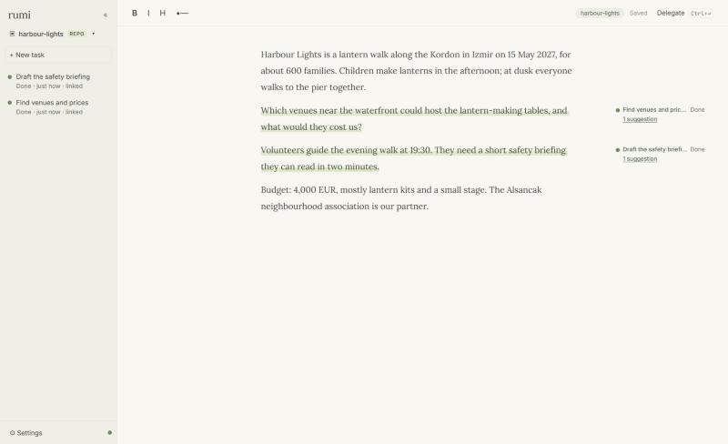
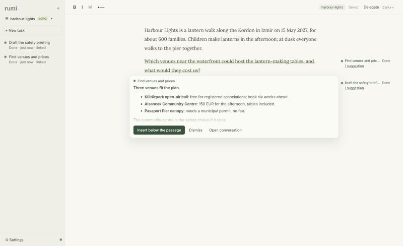

<div align="center">

# rumi

**A quiet place to write, with agents working beside your words.**

Select a passage, hand it to an agent, keep writing.<br/>
The passage stays linked to its task, and the answer comes back right where it belongs.

<br/>



<br/>
<br/>


</div>

---

## Why

Most AI writing tools put you in a chat window. Rumi keeps the **document** at the centre.

Delegated work stays attached to the text it came from. You can see at a glance which paragraphs have an agent working on them and which have an answer waiting. A paragraph you've rewritten since delegating is flagged too.

## Quick start

You need [Node 22+](https://nodejs.org) and a model configured in [Pi](https://pi.dev): local (LM Studio, llama.cpp) or hosted.

```bash
git clone https://github.com/muzaffermahi/rumi.git
cd rumi
npm ci && npm run build
npm link            # installs the `rumi` command
```

Then, from any project:

```bash
cd ~/code/my-project
rumi
```

Rumi starts in the background and opens in your browser, inside that project. `rumi stop` shuts it down.

## How it works

**Delegate.** Select text and press <kbd>Ctrl</kbd>+<kbd>Enter</kbd> (<kbd>⌘</kbd>+<kbd>↵</kbd> on macOS), or use the Delegate button that appears next to the selection. The instruction is optional. With nothing selected, the task covers the whole document.

**Linked passages.** The passage gets a soft highlight, and the task's status sits in the margin beside it. Click either one to open the task's conversation.



**Suggestions, not surprises.** A finished answer waits beside its passage as a suggestion. *Insert below the passage* puts it there, wherever your cursor happens to be.

**Edits are noticed.** Rewrite a delegated passage and its badge says *changed since delegated*. Nothing is sent until you press *Send new version*.

**One conversation per task.** Messages steer a running task or continue a finished one, in the same Pi session. Tool use stays folded away. Click the live *Working…* line to see what the agent is doing: its thinking, the command it's running, and that command's latest output.

**Context, honestly.** Each task gets the instruction, the passage, and your whole document, clearly labelled as background rather than instructions. Long documents are cut to the text around the passage, and the agent is told so. You can see exactly what was sent.

**Research without keys.** Web search merges Exa's free endpoint with DuckDuckGo. Research tasks plan first and run 5 to 30 distinct searches. A *Research the web* checkbox turns this off for pure writing tasks.

**Workspaces.** Every project folder has its own document and tasks, stored in `<project>/.rumi/` and ignored by git. There's also a Global workspace for everything else. Switch from the top of the sidebar, or just run `rumi` in another folder.

**Your models.** Rumi reads models and credentials from Pi's own configuration. Pick a default, override it per task, and run one or two tasks at a time.

## Under the hood

| | |
|---|---|
| Editor | React + [TipTap](https://tiptap.dev). Links between passages and tasks are a mark stored in the document itself |
| Agents | [Pi SDK](https://pi.dev): sessions, steering, compaction, cancellation |
| Storage | SQLite + Pi's JSONL sessions, per workspace |
| Live updates | Server-sent events, batched |
| Search | Exa (free, keyless) + DuckDuckGo HTML, Bing fallback; Readability for pages |

```text
server.mjs        HTTP API, workspaces, task queue
runtime.mjs       Pi sessions and the worker's tools
lib/              context building, search, queue, conversation reading, storage
src/              the interface (document, margin, task pane)
bin/rumi.mjs      the `rumi` command
```

`npm test` runs the test suite.

## Good to know

- **Local and trusted.** Agents run on your computer with file and shell access. A task folder is a working location, not a sandbox.
- **No time limits.** A task runs until it finishes or you press Stop. On restart, unfinished tasks wait for you to resume them.
- **Same-folder tasks run one at a time** unless you allow side-by-side runs in Settings.
- **Windows tested.** The folder picker uses Windows' native dialog; elsewhere, paste a path or run `rumi` in the folder.

<div align="center">
<br/>
<sub>Built on <a href="https://pi.dev">Pi</a>. Named after the poet who wrote about the field beyond right and wrong. Here, it's the space between thinking and delegating.</sub>
</div>
