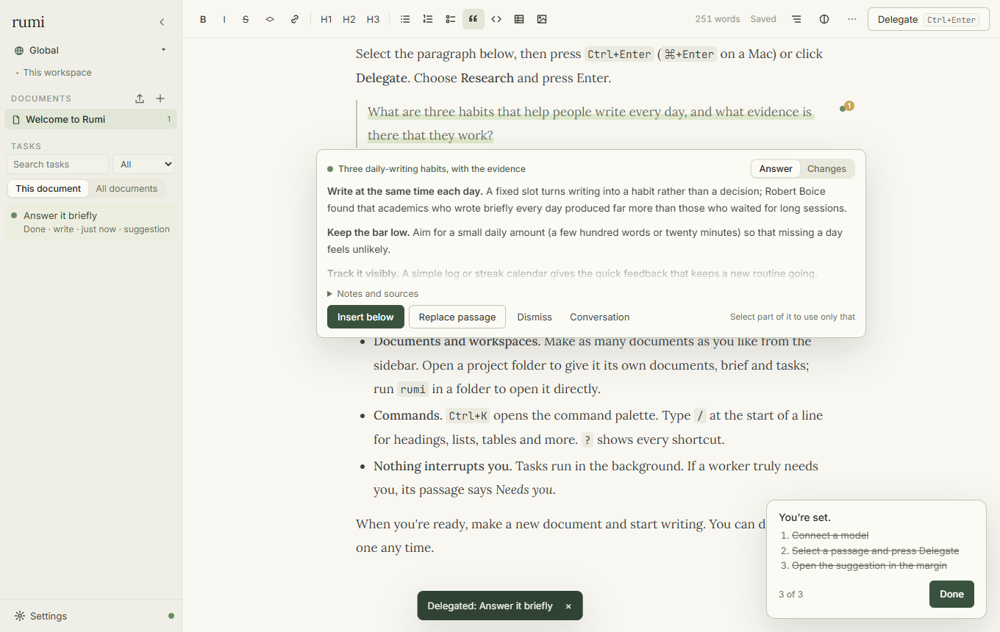
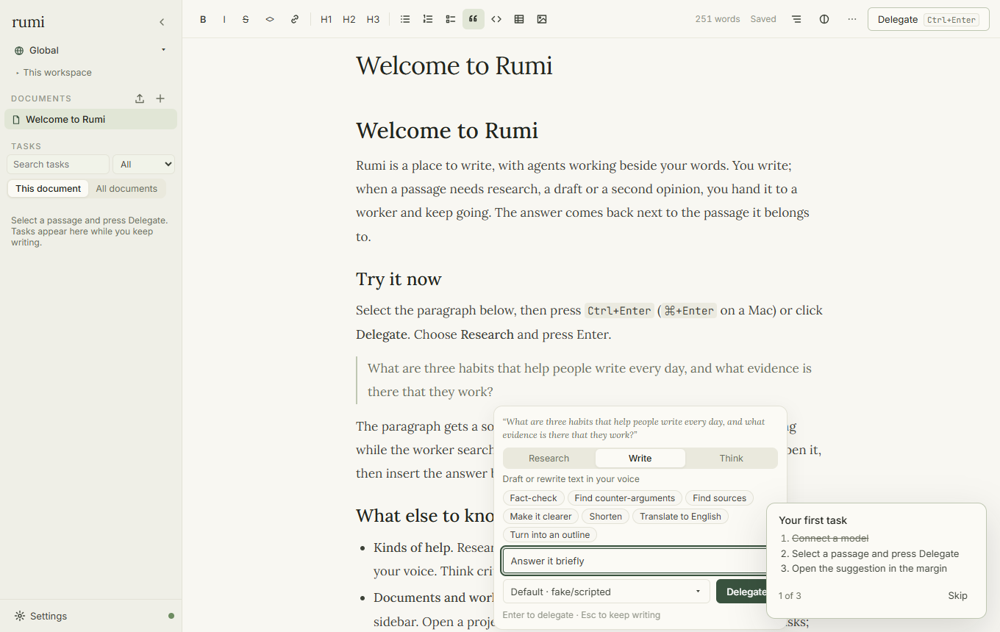
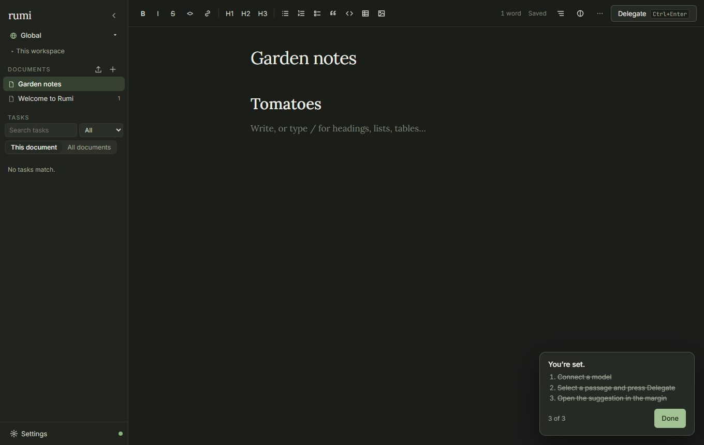

<div align="center">


# rumi

**Stop prompting and waiting. Keep thinking, and let agents work in the margins.**

[](https://github.com/muzaffermahi/rumi/actions/workflows/ci.yml)
[](LICENSE)




</div>

## The problem with prompt, wait, read, repeat

Working with AI today mostly means taking turns. You write a prompt, then you wait. You read what comes back, write the next prompt, and wait again. Each turn pulls your attention out of your own thinking and into the agent's. Run three agents and you're juggling three chat windows. Your ideas end up scattered across conversations, and the clearest picture of what you're doing lives in a transcript you'll never reread.

**Rumi turns this around.** You stay in one document: your plan, your argument, your notes, whatever you're thinking through. When a passage needs research, a draft, a critique or a code change, you hand just that passage to a worker with one keystroke and **keep writing**. No turn to wait for. The answer comes back beside the passage it belongs to, and you take it in when you reach that point, on your schedule.

## What changes when you work this way

- **You stay at the centre.** The document is yours and it's the real work. Agents serve it. Nothing they produce lands in it unless you put it there.
- **Your thinking gets clearer.** Writing *is* thinking, and you never stop doing it. Delegating forces you to say exactly what you need from each passage, and the answers arrive where they make sense, not in a separate feed.
- **Managing many agents becomes calm.** Each task is pinned to the words it's about, so the document is the dashboard. You can see at a glance what's running, what's done and what needs you, without a wall of agent chatter.
- **The document is the brief.** Every worker reads the whole document as context, so saying what you're making, who it's for and how you like things done at the top briefs every task at once.
- **Workers you can leave alone.** They're told you aren't watching. They assume and note instead of stopping to ask, hand back material written for your document rather than a chat reply, and ask one clear question only when they truly can't continue.

## How it feels

1. **Write.** Get your thinking onto the page.
2. **Delegate.** Select a passage and press <kbd>Ctrl</kbd>+<kbd>Enter</kbd> (<kbd>⌘</kbd>+<kbd>↵</kbd>). Pick **Research**, **Write**, **Think** or **Build**, or a saved instruction like *Fact-check* or *Shorten*. Add a line about what you want, or don't.
3. **Keep writing.** The passage gets a soft highlight and its task's status sits in the margin. Delegate the next thing, and the next.
4. **Review when you're ready.** The margin says *1 suggestion*. Insert the answer below the passage, **replace the passage with a word-by-word diff**, take only the part you select, or dismiss it. Every change is one undo away, and Rumi saves a version before touching your text.



## Install

**macOS and Linux**

```bash
curl -fsSL https://github.com/muzaffermahi/rumi/releases/latest/download/install.sh | sh
```

**Windows** (PowerShell)

```powershell
irm https://github.com/muzaffermahi/rumi/releases/latest/download/install.ps1 | iex
```

**From source** (Node 22.19+)

```bash
git clone https://github.com/muzaffermahi/rumi.git
cd rumi && npm ci && npm run build && npm link
```

Then run `rumi` in any folder. Rumi opens in your browser, in that folder's workspace. The first screen connects a model: sign in with a subscription you already pay for (ChatGPT, Claude, Copilot, Grok and more), paste an API key, or use LM Studio, Ollama or any OpenAI-compatible server on your computer. If you use [Pi](https://pi.dev), Rumi can share its sign-ins.

## What's inside

| | |
|---|---|
| **Writing** | Many documents per workspace, tables, checklists, highlighted code, images, outline, focus mode, a slash menu, Markdown import and export, version history, dark mode |
| **Delegating** | Research (searches the web, no API key needed, cites sources), Write, Think, Build, saved instructions, any connected model per task |
| **Reviewing** | Answers beside their passage; insert, replace with a diff, take a part, or dismiss; run a task again on another model and compare |
| **Build tasks** | In a project folder: edit files and run commands, checkpointed so you can review the diff and revert in one click, or run on their own git branch |
| **Staying in control** | Commands after a web read wait for your approval; workers can't reach your computer or local network; non-Build tasks can't change your project |
| **Extending** | Your own task kinds and saved instructions as Markdown files, Pi packages and MCP servers per workspace, Brave, Tavily or SearXNG search |
| **Getting around** | Command palette (<kbd>Ctrl</kbd>+<kbd>K</kbd>), keyboard shortcuts (<kbd>?</kbd>), `rumi` in a terminal, `rumi delegate` from scripts |



## The command line

```bash
rumi                      # open Rumi on this folder
rumi delegate "Find three recent studies on spaced repetition" --kind research --wait
rumi status               # running? which port, which models
rumi doctor               # check everything Rumi needs, with fixes
rumi setup                # connect local models, open the sign-in screen
rumi update               # update the way you installed it
rumi stop
```

`rumi --help` lists everything. Settings live in `~/.rumi/config.json` (with a [JSON schema](schema/config.schema.json)); `rumi config set theme dark` changes one.

## Privacy

Rumi runs on your computer. No account, no server of ours, no telemetry. Your documents go only to the model you choose, as context for the tasks you delegate. The local server only answers this computer's browser, with an access token. [SECURITY.md](SECURITY.md) explains what each kind of task can touch.

## Contributing

Contributions are welcome. Start with [CONTRIBUTING.md](CONTRIBUTING.md) and [ARCHITECTURE.md](ARCHITECTURE.md). The whole test suite runs against a scripted model, so it needs no API keys. See [CHANGELOG.md](CHANGELOG.md) for what's new.

<div align="center">
<br/>
<sub>MIT licensed. Built on <a href="https://pi.dev">Pi</a>. Named after the poet who wrote about the field beyond right and wrong; here, it's the space between thinking and delegating.</sub>
</div>
